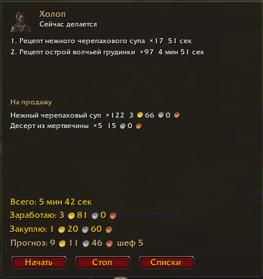
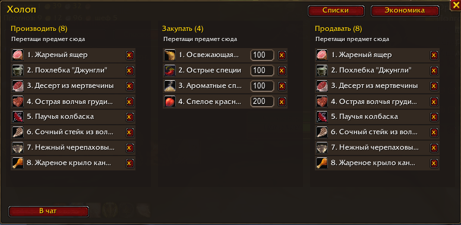
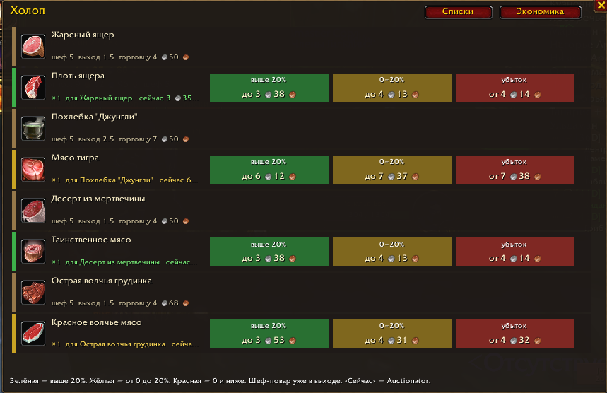

# Холоп

  

Аддон для выгодного крафта в World of Warcraft: Forever.

Холоп крафтит за вас, закупает материалы у торговца, продаёт продукцию торговцу и помогает купить материалы на аукционе так, чтобы крафт остался в плюсе. Он считает будущую прибыль и зовёт вас, если без нажатия кнопки крафт дальше не пойдёт.

## Установка в WoW Forever

Холоп ставится только в клиент **World of Warcraft: Forever**. Папка обычного WoW, Classic или Era его не загрузит.

1. Скачайте архив: [wow-holop-forever-main.zip](https://github.com/coolguywbp/wow-holop-forever/archive/refs/heads/main.zip).
2. Распакуйте его. Внутри будет папка `wow-holop-forever-main`. Переименуйте её в `Holop`.
3. В этой папке файл `Holop.toc` должен лежать сразу, а не в ещё одной вложенной папке `Holop`.
4. Скопируйте папку `Holop` сюда:

`World of Warcraft\_forever_\Interface\AddOns\Holop`

Если папки `Interface\AddOns` ещё нет, создайте её. Установленный клиент выглядит так: `_forever_\Interface\AddOns\Holop\Holop.toc`.

5. Полностью перезапустите клиент Forever. На экране выбора персонажа откройте **Аддоны** и включите **Холоп**.
6. Войдите в игру и проверьте: `/holop list` открывает списки.

Позже, чтобы обновить аддон, замените папку `Holop` новой и в игре напишите `/reload`.

## Что умеет

- Крафтит предметы из списка **Производить**. Один рецепт делается до конца, затем Холоп зовёт: **Хозяиииииин**. Дальше нужно нажать **Начать**. Сам он персонажа не водит.
- По списку **Закупать** докупает материалы у торговца до нужного количества. Число на иконке товара — размер одной покупки, а не остаток на прилавке.
- По списку **Продавать** сдаёт торговцу всё, что уже лежит в сумках.
- В окне профессии показывает очередь, время работы, сколько будет заработано и сколько уйдёт на закупку.
- **Прогноз** считает продажу очереди торговцу вместе с тем, что уже лежит на продажу. Для кулинарии учитывается талант **Шеф-повар**: каждое очко даёт 10% шанса получить одну лишнюю порцию.
- Вкладка **Экономика** — реестр закупок на аукционе. У каждой позиции иконка и три цены:
  - зелёная — рентабельность выше 20%;
  - жёлтая — от 0 до 20%;
  - красная — ноль и убыток.
  Текущая цена берётся из Auctionator, если он установлен.

## Как пользоваться

1. `/holop list` или кнопка **Списки**.
2. Перетащите готовые вещи в **Производить**, материалы в **Закупать**, то что сдавать торговцу — в **Продавать**.
3. Откройте профессию у костра или станка и нажмите **Начать**.
4. Зайдите к торговцу: Холоп продаст и докупит сам.
5. Вкладка **Экономика** или `/holop eco` покажет, что брать на аукционе и до какой цены.

## Команды

| Команда | Действие |
| --- | --- |
| `/holop` | Начать или остановить крафт |
| `/holop list` | Открыть списки |
| `/holop eco` | Открыть экономику |
| `/holop clear` | Очистить три списка |
| `/holop debug` | Вывести списки в чат |

## Требования

- World of Warcraft: Forever, интерфейс 16001.
- Auctionator нужен только для строки **сейчас** на аукционе. Потолок цены считается и без него.

## Как выглядит

Окно у профессии: очередь, продажа и прогноз.

Списки: производить, закупать, продавать.

Экономика: что купить на аукционе и до какой цены.

## English

Holop is a World of Warcraft: Forever addon for profitable crafting. It crafts from your list, buys reagents from vendors, sells finished goods to vendors, and shows the auction prices that still leave a profit. It forecasts the payout and calls you when the next craft needs a click.

Green prices are above 20% return, yellow is 0–20%, and red is break-even or a loss. Cooking includes the Master Chef legacy talent.

Install it only in the Forever client. Download the repository zip, rename the unpacked folder to `Holop`, and copy it to `World of Warcraft\_forever_\Interface\AddOns\Holop`. `Holop.toc` must sit directly in that folder. Restart the client once, enable Holop in the addons list, then type `/holop list`.
